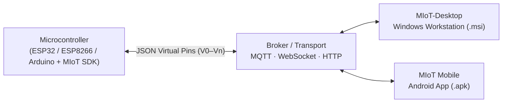
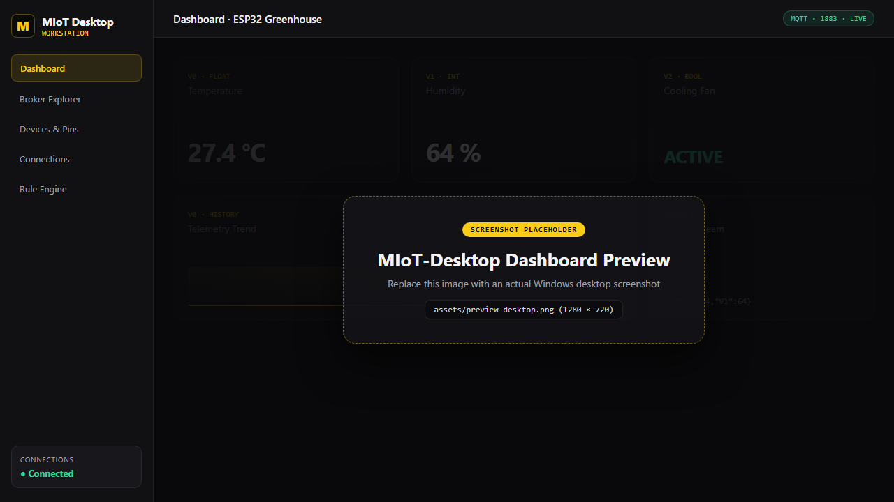
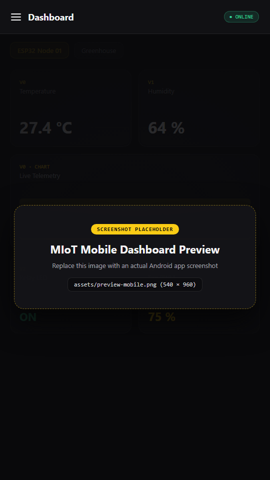

<div align="center">


# MIoT Ecosystem

**End-to-End IoT Monitoring, Control & Telemetry Platform**

*Unified Virtual Pin (`V0`–`Vn`) JSON protocol across Microcontroller SDK, Windows Desktop Workstation, and Android Mobile App.*


-34D399?style=flat-square&labelColor=111114)
-38BDF8?style=flat-square&labelColor=111114)


[Downloads](#release-downloads) · [Dashboard Preview](#dashboard-preview) · [Firmware Example](#quick-example-esp32-mqtt) · [Verification](#checksum-verification-sha-256)

</div>

---

## Overview

**MIoT** is an integrated IoT ecosystem designed to bridge microcontroller hardware with cross-platform monitoring and control clients using a lightweight **Virtual Pin (`V0`–`Vn`) JSON wire protocol** over **MQTT**, **WebSocket**, and **HTTP**.



### Ecosystem Components

| Component | Package | Platform | Key Capabilities |
| :--- | :--- | :--- | :--- |
| **MIoT-Desktop** | `MIoT-Desktop-1.0.0.msi` | Windows 10 / 11 (x64, bundled JRE) | Adaptive multi-column dashboard, Broker Explorer (wildcard `#` subscribe & interactive publish), Split-Pane Packet Inspector, SQLite history analytics, local Rule Engine, system tray, JSON workspace backup |
| **MIoT Mobile** | `MIoT-v1.0.0.apk` | Android 7.0+ (API 24+) | 10 real-time monitoring & control widgets (Value, Gauge, Line Chart, LED, Toggle, Slider, Terminal, etc.), foreground background service, local threshold alerts, RFC-4180 CSV export |
| **MIoT Firmware SDK** | `MIoT-v1.0.0.zip` | ESP32 · ESP8266 · ESP-01 · Arduino | Zero external dependencies (built-in JSON parser & MQTT 3.1.1 client), `MIoTMqttClient`, `MIoTHttpServer`, `MIoTHttpClient`, ESP-01 AT modem driver, single-pin & batch JSON telemetry |

---

## Dashboard Preview

> [!NOTE]
> The preview images below are placeholders stored in `assets/`. Replace `assets/preview-desktop.png` and `assets/preview-mobile.png` with actual screenshots when publishing a release.

<table>
  <tr>
    <th width="68%">Desktop Workstation (<code>MIoT-Desktop</code>)</th>
    <th width="32%">Android App (<code>MIoT Mobile</code>)</th>
  </tr>
  <tr>
    <td align="center">
      
    </td>
    <td align="center">
      
    </td>
  </tr>
</table>

---

## Release Downloads

All compiled installers and SDK archives are distributed via the **Releases** section of this repository:

| Artifact | Target | Installation Summary |
| :--- | :--- | :--- |
| **`MIoT-v1.0.0.apk`** | Android 7.0+ | Download the `.apk`, enable **Install unknown apps** if prompted, install, and configure a broker profile in **Connections**. |
| **`MIoT-Desktop-1.0.0.msi`** | Windows 10 / 11 (x64) | Run the `.msi` installer (Java 17 runtime is bundled—no separate JDK installation required), then launch **MIoT** from the Start Menu. |
| **`MIoT-v1.0.0.zip`** | Arduino IDE / PlatformIO | In Arduino IDE: **Sketch → Include Library → Add .ZIP Library…** and select `MIoT-v1.0.0.zip`. In PlatformIO: extract into `lib/MIoT`. |

---

## Quick Example (ESP32 MQTT)

Below is a complete microcontroller sketch demonstrating how **MIoT Firmware SDK** publishes batch sensor telemetry (`V0`, `V1`) and handles incoming actuator commands (`V2`) with zero external library dependencies:

```cpp
#include <WiFi.h>
#include <MIoT.h>

const char* WIFI_SSID = "YOUR_WIFI_SSID";
const char* WIFI_PASS = "YOUR_WIFI_PASSWORD";

const char* MQTT_HOST = "broker.hivemq.com";
const uint16_t MQTT_PORT = 1883;
const char* TOPIC_PUB = "miot/esp32_01/telemetry";
const char* TOPIC_SUB = "miot/esp32_01/cmd";

WiFiClient wifiClient;
MIoTMqttClient mqttTransport(wifiClient);
MIoTClient miot;

unsigned long lastSendMs = 0;

void onLedPin(const String& pin, const MIoTPinValue& val) {
  bool state = val.asBool();
  digitalWrite(LED_BUILTIN, state ? HIGH : LOW);
  Serial.printf("[CMD] %s -> %s\n", pin.c_str(), state ? "ON" : "OFF");
}

void setup() {
  Serial.begin(115200);
  pinMode(LED_BUILTIN, OUTPUT);

  WiFi.begin(WIFI_SSID, WIFI_PASS);
  while (WiFi.status() != WL_CONNECTED) {
    delay(500);
    Serial.print(".");
  }
  Serial.println("\nWiFi connected: " + WiFi.localIP().toString());

  mqttTransport.configure(MQTT_HOST, MQTT_PORT, "miot-esp32-01");
  miot.onPinWrite("V2", onLedPin);
  miot.begin(mqttTransport, TOPIC_PUB, TOPIC_SUB);
}

void loop() {
  miot.loop();

  if (millis() - lastSendMs >= 5000) {
    lastSendMs = millis();
    float temp = 25.0f + (random(0, 100) / 10.0f);
    int hum = random(50, 80);

    // Send batch Virtual Pin JSON: {"V0":27.30,"V1":64}
    miot.beginBatch();
    miot.batchWrite("V0", temp, 2);
    miot.batchWrite("V1", hum);
    miot.endBatch();
  }
}
```

<details>
<summary>Alternative Example: Local HTTP Polling Mode (ESP32 HTTP Server)</summary>

```cpp
#include <WiFi.h>
#include <MIoT.h>

const char* WIFI_SSID = "YOUR_WIFI_SSID";
const char* WIFI_PASS = "YOUR_WIFI_PASSWORD";

WiFiServer wifiServer(80);
MIoTHttpServerT<WiFiServer> httpServer(wifiServer);
MIoTClient miot;

unsigned long lastUpdateMs = 0;

void onRelayPin(const String& pin, const MIoTPinValue& val) {
  bool state = val.asBool();
  digitalWrite(LED_BUILTIN, state ? HIGH : LOW);
  miot.virtualWrite("V2", state);
}

void setup() {
  Serial.begin(115200);
  pinMode(LED_BUILTIN, OUTPUT);

  WiFi.begin(WIFI_SSID, WIFI_PASS);
  while (WiFi.status() != WL_CONNECTED) {
    delay(500);
  }
  Serial.println("HTTP Server ready: http://" + WiFi.localIP().toString());

  miot.onPinWrite("V2", onRelayPin);
  miot.begin(httpServer);
}

void loop() {
  miot.loop();

  if (millis() - lastUpdateMs >= 2000) {
    lastUpdateMs = millis();
    miot.beginBatch();
    miot.batchWrite("V0", 26.5f + (random(0, 50) / 10.0f), 2);
    miot.batchWrite("V1", random(40, 80));
    miot.endBatch();
  }
}
```

</details>

### Virtual Pin JSON Format

* **Single pin**: `{"pin":"V0","val":28.5}`
* **Batch pins**: `{"V0":27.30,"V1":64,"V2":true}`

---

## Checksum Verification (SHA-256)

Verify downloaded binaries against the release checksums before installation:

```powershell
# Windows (PowerShell)
Get-FileHash .\MIoT-Desktop-1.0.0.msi -Algorithm SHA256
```

```bash
# Linux / macOS
sha256sum MIoT-v1.0.0.apk MIoT-v1.0.0.zip
```
